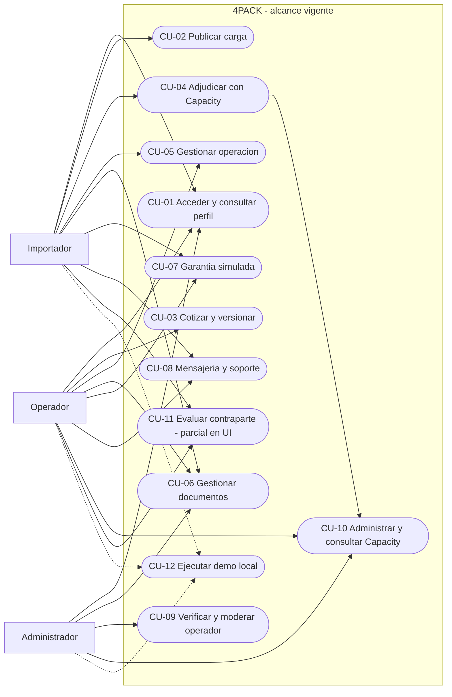

# 03. Casos de uso de 4PACK

Seminario Final — Chavez Yoshua Facundo. Corte: 15/11/2026. Estado del documento: **completo para revisión académica**. Alcance: checkpoint Capacity 2B; convenciones en [README](README.md).

## Actores y diagrama general

Importador, operador y administrador son actores humanos autenticados. Auth, Storage y PostgreSQL son componentes del sistema, no actores comerciales. En la demo, algunas identidades son ficticias y no representan sesiones productivas.

Mermaid no ofrece un diagrama UML de casos de uso nativo: se utiliza un flowchart con actores y actividades. Las flechas entre casos expresan dependencia funcional y no una declaración formal de `include`/`extend`.

## CU-01. Acceder y consultar perfil

- **Actores/canal:** todos; acceso web o mobile. **Estado:** implementado para cuentas existentes. Requisitos RW-01/02, RM-01/02.
- **Precondiciones:** cuenta provisionada y entorno Auth configurado; para demo, entorno local/Preview permitido.
- **Flujo:** 1) ingresar credenciales; 2) validar sesión con Auth; 3) consultar perfil/rol; 4) abrir las funciones autorizadas. Web deriva al operador a su panel; mobile presenta tabs autenticadas y valida permisos por acción.
- **Alternativos/errores:** credenciales inválidas, sesión vencida o configuración ausente muestran error/redirección. Una cuenta pendiente o suspendida conserva consulta de perfil/soporte/capacidad propia, pero no recibe permiso para cotizar.
- **Postcondición:** sesión utilizable y datos conforme al rol; no se modifica el rol ni se aprueba al operador por iniciar sesión.
- **Evidencia:** `operatorSession`, `proxy.ts`, login mobile, migración 0004.

## CU-02. Publicar carga

- **Actor/canal:** importador; web y mobile. **Estado:** parcial: publicación de datos implementada; clasificación heurística y expediente HAZMAT no completos. RW-03/04, RM-03/04.
- **Precondiciones:** sesión importador; datos válidos y positivos para peso/volumen.
- **Flujo:** 1) completar descripción, ruta, categoría, dimensiones, FOB y modalidad; 2) validar campos; 3) calcular señal heurística de posible material peligroso; 4) insertar carga propia abierta con plazo; 5) confirmar publicación.
- **Alternativos/errores:** campos inválidos impiden guardar; un rol diferente no puede publicar; fallo de red o RLS no acredita el flujo completo. La señal de riesgo exige revisión documental, no asegura clasificación técnica. En web, la rama MSDS heredada intenta subida directa incompatible con 0015, después de insertar carga; su limpieza por DELETE también puede ser rechazada por RLS de 0016. Por inspección, puede quedar carga persistida pese al mensaje de error. Mobile marca MSDS requerido sin adjuntarlo en este flujo. No se da por implementada la publicación HAZMAT íntegra.
- **Postcondición del camino básico exitoso:** carga persistida con su importador; disponible para operadores autorizados. El FOB no reserva capacidad del operador. La rama HAZMAT requiere verificación/corrección posterior autorizada; no garantiza una postcondición atómica actual entre carga y MSDS.
- **Evidencia:** páginas de publicación, `createCargo`, `requiresHazmatReview`, políticas 0016.

## CU-03. Elaborar y presentar cotización privada

- **Actor/canal:** operador aprobado, web. **Estado:** implementado. RW-05–08; RM-11 excluye la acción mobile.
- **Precondiciones:** licitación abierta, plazo vigente, operador habilitado; sin otra propuesta activa incompatible para la carga.
- **Flujo:** 1) abrir oportunidad; 2) completar alcance/términos/precio/moneda/capital estimado; 3) guardar y revisar borrador propio; 4) presentar; 5) validar en SQL y sellar la versión.
- **Alternativos/errores:** puede guardar incompleto como borrador; al presentar se rechaza capital ausente, negativo, superior al precio o de otra moneda. Puede retirar/reemplazar una propuesta vigente creando otra revisión. Si venció/cerró, no se altera. La advertencia de capacidad es informativa y no reserva.
- **Postcondición:** propuesta privada e inmutable; importador de la carga puede compararla, competidores no. El borrador permanece privado.
- **Evidencia:** `QuoteEditor`, `quote_command`, migraciones 0018/0021 y pruebas 2A/2B.

## CU-04. Adjudicar con Capacity

- **Actor/canal:** importador dueño de la carga, web. **Estado:** implementado localmente; ensayo multiconexión pendiente. RW-09–11; RM-12 parcial multicanal.
- **Precondiciones:** oferta presentada y vigente, licitación adjudicable, operador aprobado, capacidad administrativamente configurada y vigente.
- **Flujo:** 1) comparar alcance y moneda; 2) seleccionar oferta; 3) llamar `award_offer`; 4) tomar locks del operador/capacidad y carga; 5) validar precio por operación, exposición y capital de la moneda, cantidad/peso/volumen globales; 6) crear operación, reserva, snapshot, garantía simulada y eventos en una transacción; 7) confirmar resultado.
- **Alternativos/errores:** capacidad insuficiente devuelve el mensaje genérico sin límites ni motivos privados; todo se revierte. Oferta vencida, suspensión o ganador previo rechazan el flujo. Reintentar la misma adjudicación devuelve la operación existente. Una cotización histórica sin capital no se completa con cero.
- **Postcondición:** una sola operación por carga, una reserva por operación y garantía íntegra; o ningún resultado parcial. No se transfieren fondos.
- **Evidencia:** 0016/0018/0022, `reserve_operation_capacity`, tests de rollback e idempotencia.

## CU-05. Ejecutar y cerrar una operación

- **Actores/canal:** operador web e importador web/mobile; administrador para fallos/cancelaciones documentados. **Estado:** principal implementado; controversia completa fuera del MVP. RW-12/23, RM-05/06/08.
- **Precondiciones:** participación autorizada, operación creada y garantía simulada retenida para el avance que la requiere.
- **Flujo:** 1) confirmar garantía simulada; 2) operador pasa de confirmed a in_progress; 3) registra hitos; 4) solicita confirmación de entrega; 5) importador confirma completed; 6) sistema aplica cierre simulado y libera capacidad una vez.
- **Alternativos/errores:** rol/fase incompatibles son rechazados. Incident y disputed conservan capacidad. Cancelled requiere registro administrativo de consecuencias y fase de origen válida; failed solo desde incident y por administrador. Un fallo revierte también la decisión terminal. La retención simulada puede quedar pendiente de revisión; no se liquida una controversia.
- **Postcondición:** nueva fase/evento coherentes o rechazo sin avance. Completed libera capacidad; cancelación/fallo siguen sus reglas, sin inferir reembolso.
- **Evidencia:** contrato JSON, `transition_operation`, `capacity_phase`, `admin_capacity_terminal_transition`.

## CU-06. Cargar, reemplazar y consultar documentos

- **Actores/canal:** importador/operador participantes, administrador según permisos; web. **Estado:** implementado localmente, infraestructura remota pendiente. RW-13/14, RM-13 parcial.
- **Precondiciones:** sesión válida y destino autorizado: una carga, operación o perfil de operador.
- **Flujo:** 1) seleccionar destino y archivo; 2) enviar al gateway `document-upload`; 3) comprobar extensión/MIME/firma y tamaño de hasta 10 MiB; 4) guardar objeto y metadatos enlazados; 5) consultar/descargar previa autorización.
- **Alternativos/errores:** formato distinto de PDF/PNG/JPEG, tamaño inválido o destino ajeno rechazan. Conocer una ruta de Storage no concede lectura. Reemplazar referencia el documento anterior; no borra la evidencia. Objetos históricos sin asociación confiable pueden permanecer no disponibles.
- **Postcondición:** documento vinculado a un único destino, con objeto autorizado y trazabilidad; no se certifica autenticidad legal de su contenido por validar la firma de formato.
- **Evidencia:** 0015, `document_objects`, gateway y tests de seguridad documental.

## CU-07. Registrar garantía y movimientos simulados

- **Actor/canal:** importador participante web/mobile; operador consulta wallet en web. **Estado:** implementado como simulación; retiros/liquidación parciales. RW-17/18, RM-07.
- **Precondiciones:** operación adjudicada y garantía pendiente; actor autorizado.
- **Flujo:** 1) importador confirma que ejecutará una simulación; 2) `simulate_guarantee` valida pertenencia; 3) registra held_simulated y confirma operación; 4) al completar, aplica liberación/movimiento y comisión simulados de la moneda contractual; 5) operador consulta el resultado.
- **Alternativos/errores:** sin sesión, operación ajena o estado incompatible se rechaza. No existe validación bancaria ni pago por tramos. La solicitud de retiro solo registra una intención simulada.
- **Postcondición:** evidencia académica de garantía/movimiento; ninguna obligación de custodia real queda acreditada por este flujo.
- **Evidencia:** `simulate_guarantee`, `sync_simulated_finance`, wallet y pruebas de moneda.

## CU-08. Comunicar novedades y solicitar soporte

- **Actores/canal:** participantes de operación, web/mobile; operador crea soporte en web. **Estado:** implementado en los canales indicados; atención humana fuera de la automatización. RW-15/16/24, RM-09/10.
- **Precondiciones:** sesión, participación o titularidad del ticket, texto válido.
- **Flujo:** 1) abrir conversación asociada a operación o ticket; 2) escribir y enviar; 3) validar actor/contenido; 4) persistir; 5) consultar historial y, en soporte web, adjunto autorizado cuando corresponda.
- **Alternativos/errores:** acceso ajeno, texto vacío/excesivo y contenido bloqueado se rechazan según validaciones actuales; fallo de red exige verificar envío. Los controles no aseguran impedir todo contacto externo.
- **Postcondición:** mensaje atribuible al emisor, sin crear una conversación separada de la operación. El ticket no garantiza tiempo de respuesta.
- **Evidencia:** `messages`, `support_tickets`, `support_messages`, panel y dashboard mobile.

## CU-09. Verificar y moderar al operador

- **Actor/canal:** administrador web; operador aporta perfil/documentación. **Estado:** parcial: aprobación/rechazo y moderación en UI; suspensión aplicada en datos/reglas, sin botón específico identificado. RW-02/06/19.
- **Precondiciones:** sesión administrativa; cuenta operador y datos disponibles.
- **Flujo:** 1) revisar perfil y evidencia; 2) aprobar/rechazar mediante la interfaz existente; 3) guardar estado, fecha y administrador; 4) moderar publicación comercial si corresponde; 5) reflejar habilitación en catálogo y cotización. El flujo de suspensión no se presenta como una acción completa de esta pantalla.
- **Alternativos/errores:** operador no puede cambiar su aprobación ni revertir moderación administrativa. Suspensión impide nuevas reservas/ofertas, pero conserva las obligaciones y reservas previas. No hay verificación automática contra registros profesionales.
- **Postcondición:** habilitación documental/comercial actualizada. No implica aprobación de límites económicos de Capacity.
- **Evidencia:** administración operadores, controles de rol y RPC comercial 0017.

## CU-10. Aprobar y consultar Capacity

- **Actores/canal:** administrador configura, operador consulta; web. **Estado:** implementado localmente. RW-21–23, RNW-02.
- **Precondiciones:** administrador autenticado y destino con rol operador; para consulta propia, sesión operador.
- **Flujo:** 1) buscar empresa y revisar su verificación; 2) inspeccionar consumo/reservas; 3) revisar capital histórico desconocido con motivo; 4) configurar límites globales y por USD/ARS, vigencia/estado y capital declarado/aprobado; 5) guardar con motivo; 6) consultar auditoría. El operador accede a su vista sin edición.
- **Alternativos/errores:** rechazar no operador, falta de motivo, capital aprobado mayor al declarado o reducción bajo consumo. Una moneda puede estar inactiva sin desactivar otra. Importador y competidor no obtienen cifras privadas. Sin configuración, la cuenta queda pendiente de evaluación económica.
- **Postcondición:** aprobación administrativa trazable; no es evaluación crediticia automática ni disponibilidad garantizada para una futura oferta.
- **Evidencia:** 0020–0022, `configure_operator_capacity`, `operator_capacity_snapshot`, pruebas 2B.

## CU-11. Evaluar a la contraparte

- **Actores/canal:** importador/operador participantes; reglas bilaterales SQL, editor web existente. **Estado:** parcial en experiencia integral por rol. RW-20, RM-13.
- **Precondiciones:** operación completed, autor participante y destinatario la contraparte, sin evaluación previa de ese autor.
- **Flujo:** 1) abrir operación finalizada; 2) elegir puntaje de 1 a 5 y comentario; 3) insertar evaluación autorizada; 4) consultar reputación agregada por rol, con cantidad de evaluaciones y operaciones.
- **Alternativos/errores:** operación no completada, autor ajeno, destinatario incorrecto o duplicado son rechazados. Sin historial se muestra ausencia de datos, no un promedio inventado. El panel del operador recibe/muestra evaluaciones; no se da por disponible allí un editor bilateral completo. No hay editor mobile identificado.
- **Postcondición:** evaluación única vinculada a operación, separando rol importador/operador. No equivale a un puntaje de riesgo crediticio.
- **Evidencia:** `OperationRating`, RLS `participants rate completed counterpart`, `public_reputation`, tests etapa 1.

## CU-12. Demostrar el sistema localmente

- **Actores/canal:** expositor con identidades ficticias; navegador. **Estado:** implementado para local/Preview; publicación no ejecutada aquí. RW-25.
- **Precondiciones:** dependencias disponibles y demo habilitada por entorno.
- **Flujo:** 1) abrir acceso demo; 2) elegir escenario; 3) crear/abrir base PGlite con SQL y fixtures; 4) recorrer panel, oferta, operación y capacidad; 5) observar persistencia local.
- **Alternativos/errores:** producción bloquea demo. Una base temporal vieja de desarrollo puede requerir regeneración local; no se reescribe una migración aplicada para fingir upgrade. No demuestra conectividad con Supabase remoto ni concurrencia real.
- **Postcondición:** evidencia reproducible de funciones académicas con datos ficticios; ningún movimiento de fondos ni migración remota.
- **Evidencia:** demo-runtime, demo-environment y `demo-preview.test.mjs`.

## Exclusiones

No se especifican como casos implementados la contratación directa, recontratación, pagos por tramos, controversias completas, Protect 3.0 ni Reputation adicional. El [Gantt](08-gantt.md) prioriza verificar las capacidades existentes, no construir esos módulos antes del cierre.
