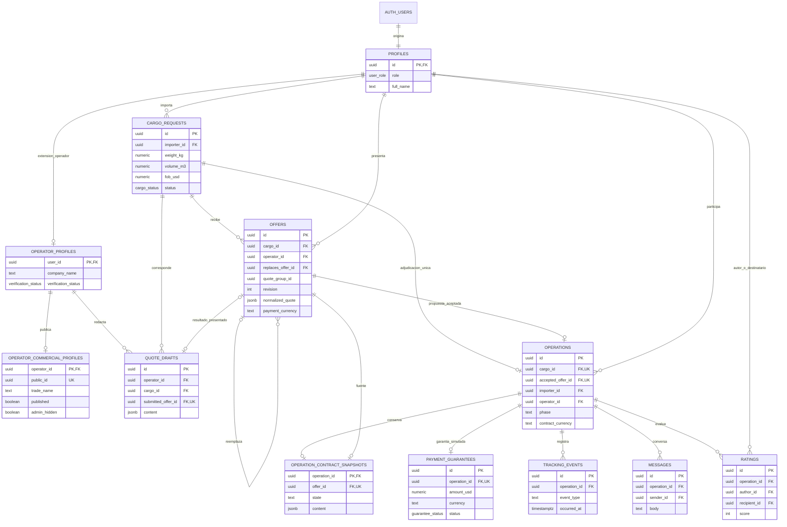
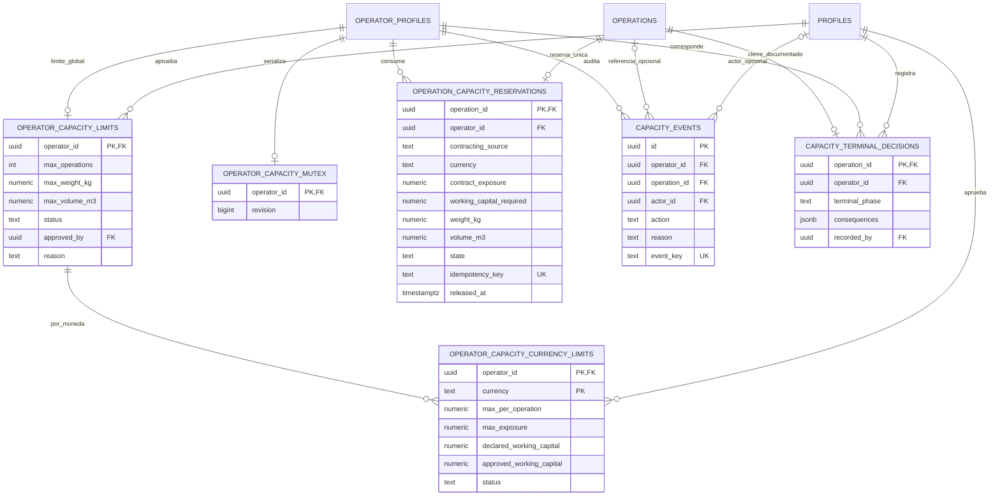
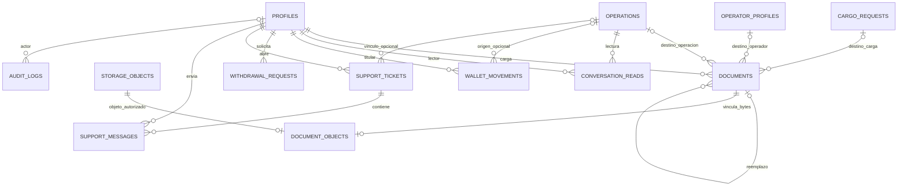

# 04. Diagrama de entidad-relación de 4PACK

Seminario Final — Chavez Yoshua Facundo. Corte: 15/11/2026. Estado del documento: **completo para revisión académica**.

## Criterio de representación

El modelo corresponde al resultado acumulado de las migraciones **0001–0022**, no solamente a 0001. Se seleccionan las claves y atributos necesarios para explicar el dominio. Los nombres son los reales de PostgreSQL; no se crean tablas conceptuales como `importadores`, `cotizaciones_items` o `payments` que el proyecto no posee.

En Mermaid, `o|` expresa cero o uno, `||` exactamente uno y `o{` cero o muchos. Una relación con un perfil no garantiza por sí misma el rol comercial: los roles se comprueban con RLS/RPC. La opcionalidad desde una entidad padre permite registros sin actividad o históricos pendientes de vincular.

## Núcleo comercial y operativo

Las entidades en mayúsculas corresponden a `auth.users` y a las tablas homónimas de `public` en minúsculas. El esquema Auth es administrado por Supabase; el trigger crea `profiles`. Importador y administrador se representan mediante `profiles.role`, sin tablas propias. `operations` tiene dos FK de participante hacia perfiles; se agrupan en una línea para no duplicar el gráfico. `ratings` tiene dos FK a perfiles, autor y destinatario.

La autorreferencia de ofertas indica que una versión puede reemplazar una anterior; el índice único parcial de `replaces_offer_id` limita a un reemplazo inmediato. `quote_drafts.submitted_offer_id` es opcional y único; `replaces_offer_id` del borrador, omitido del dibujo, referencia la propuesta a reemplazar. La cotización normalizada y el snapshot se guardan como JSONB: sus campos no son tablas adicionales.

## Submodelo Capacity incorporado en 0020–0022

La capacidad económica no es un atributo público del perfil comercial. La separación por moneda evita sumar USD y ARS. La configuración global comparte cantidad/peso/volumen entre monedas; ambas configuraciones poseen su propia vigencia/estado. El mutex es infraestructura de concurrencia, no una dimensión económica.

La reserva referencia al operador directamente, no mediante FK a sus límites: eso permite registrar consumo histórico pendiente de revisión cuando aún no existen límites aprobados. No se agregó una FK compuesta reserva-moneda/límite que impediría ese backfill. `capacity_events.operation_id` y `actor_id` pueden ser nulos; por ejemplo, una configuración no pertenece a una operación. Las fechas de reserva/activación/liberación y motivos, omitidos parcialmente del diagrama, constan en el SQL.

## Documentación, comunicación auxiliar y simulación financiera

`STORAGE_OBJECTS` representa `storage.objects`; las restantes tablas están en `public`. `documents` posee un CHECK que exige **exactamente un destino** entre cargo_id, operation_id y operator_id. La opcionalidad dibujada para cada destino no permite que falten los tres. Su `replaces_id` conserva el historial. `document_objects` tiene object_id PK, document_id único y FK diferida, storage_path único y hash SHA-256 cuando está disponible. Un documento histórico sin vínculo confiable no se supone descargable.

`conversation_reads` tiene PK compuesta operación/usuario; no existe una tabla adicional de chats. `audit_logs.entity_id` es un identificador genérico sin FK polimórfica a cada entidad: por eso no se dibujan relaciones SQL inexistentes. Se omiten del gráfico columnas y referencias auxiliares de adjuntos, no su existencia en las migraciones.

## Restricciones que afectan el análisis

1. Una carga tiene como máximo una operación y una propuesta aceptada no puede respaldar dos operaciones: claves únicas en `operations`.
2. Solo una oferta submitted/accepted por carga y operador; revisión única por quote_group_id/revision; términos presentados sellados.
3. Snapshot `complete` requiere content no nulo; `requires_review` conserva content nulo. La migración no inventa contratos históricos.
4. Reserva única por operación y clave idempotente; evento de liberación único. Reservas desconocidas conservan capital nulo y estado requiere revisión.
5. Capital aprobado ≤ declarado; importes no negativos y finitos. Peso/volumen opcionales de los límites usan null como ausencia de tope, no como cero.
6. `ratings` permite un autor por operación, puntaje de 1 a 5 y contraparte válida al completar, mediante restricciones y RLS.
7. `phase` de operación es la máquina canónica; `status` de carga/operación es una proyección histórica de menor detalle. No son dos flujos independientes.
8. Los nombres heredados `total_usd`/`amount_usd` no autorizan convertir ni sumar monedas; payment_currency/contract_currency/currency conservan la unidad contractual.

## Fuentes y alcance de verificación

Fuentes: [0001](../../supabase/migrations/0001_initial_schema.sql), [0010](../../supabase/migrations/0010_operator_panel_model.sql), [0015](../../supabase/migrations/0015_document_gateway.sql), [0016](../../supabase/migrations/0016_operation_contract.sql), [0017](../../supabase/migrations/0017_commercial_profiles.sql), [0018](../../supabase/migrations/0018_normalized_quotes.sql), [0019](../../supabase/migrations/0019_marketplace_snapshot.sql), [0020](../../supabase/migrations/0020_capacity_model.sql), [0021](../../supabase/migrations/0021_capacity_quote_contract.sql) y [0022](../../supabase/migrations/0022_capacity_workflows.sql). Las migraciones intermedias de seguridad también integran el resultado acumulado.

La estructura está implementada localmente. No se afirma que Supabase remoto tenga ya aplicadas 0020–0022. La cardinalidad física puede permitir ausencia de una fila que la RPC exige al crear una operación nueva; el diagrama no reemplaza esos invariantes transaccionales.
