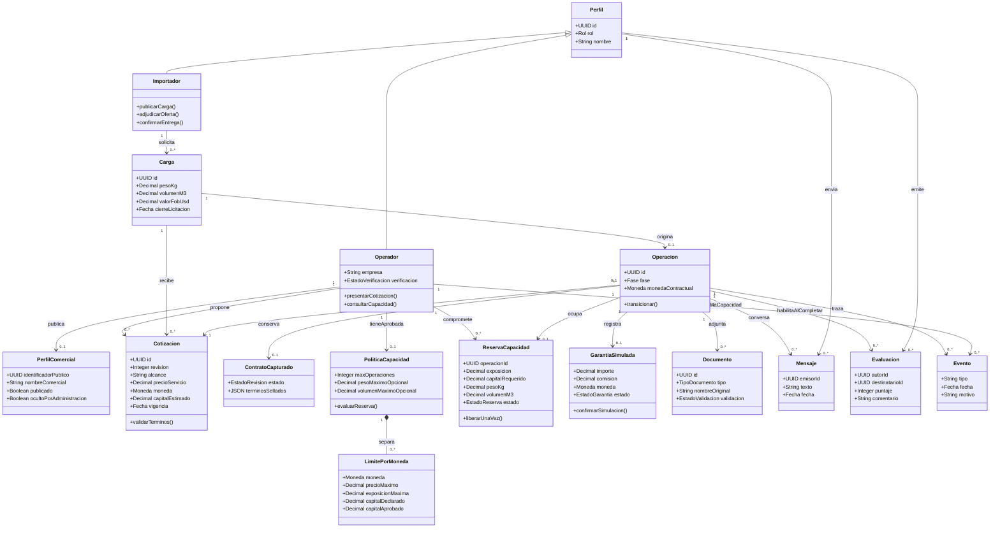

# 05. Modelo conceptual de clases de 4PACK

Seminario Final — Chavez Yoshua Facundo. Corte: 15/11/2026. Estado del documento: **completo para revisión académica**.

## Propósito

Este diagrama organiza conceptos y responsabilidades del dominio. **No afirma que exista una clase TypeScript por cada recuadro.** La implementación usa tipos, funciones, React y procedimientos SQL; el [DER](04-der.md) describe la persistencia física. Se evita convertir tablas de auditoría, mutex e índices en objetos de negocio ficticios.

Importador y operador son especializaciones conceptuales del perfil por rol, no herencia ORM. Cotización representa una versión contractual y sus términos JSONB. Borrador y propuesta presentada comparten contenido, pero tienen permisos y ciclo de vida distintos.

## Correspondencia con código y reglas

| Concepto / responsabilidad | Implementación efectiva |
| --- | --- |
| Perfil y roles | `profiles.role`, tipos `UserRole`, RLS y consulta de sesión; no hay subclases ejecutables Importador/Operador. Administrador es otro rol, omitido como clase para concentrar el dominio transaccional. |
| Publicar/adjudicar | Formulario de carga y RPC `award_offer`; los métodos dibujados expresan responsabilidades, no nombres de endpoints nuevos. |
| Cotización | `NormalizedQuote`, `validateQuote`, `quote_drafts`, `offers.normalized_quote`, revisiones e inmutabilidad SQL. Capital histórico puede ser desconocido. |
| Operación y contrato | `OperationPhase`, `operation-contract.json`, `transition_operation`, `operation_contract_snapshots`. Un histórico requiere revisión y no recibe términos inventados. |
| Política/límite | `operator_capacity_limits` y `operator_capacity_currency_limits`; aprobación solo administrativa. `evaluarReserva` corresponde a comprobaciones en `reserve_operation_capacity`, no a un servicio crediticio externo. |
| Reserva | `operation_capacity_reservations`; unicidad por operación y `release_operation_capacity`. No se pierde al suspender al operador ni al declarar disputed. |
| Garantía simulada | `payment_guarantees`, `simulate_guarantee`, `sync_simulated_finance`. No representa un saldo bancario ni un contrato de custodia. |
| Documento | `documents` y vínculo a `document_objects`/Storage autorizado; también puede pertenecer a una carga o perfil de operador, relaciones omitidas para legibilidad. |
| Mensaje | `messages` por operación; la mensajería de soporte es un contexto auxiliar separado. |
| Evaluación | `ratings` y `public_reputation`, separación por rol y operación completada. Editor integral del operador y mobile no se dan por implementados. |
| Evento | Abstracción común de trazabilidad; físicamente se distingue `tracking_events`, `capacity_events` y auditoría. No existe una tabla única `eventos`. |

La composición de límites por moneda expresa que pertenecen a una política del operador; no implica borrado en cascada no declarado. Las cardinalidades cero o uno en contrato/garantía/reserva contemplan historia y límites físicos: el flujo nuevo autorizado crea los registros que necesita dentro de la transacción.

## Invariantes

- Precio del servicio, FOB, exposición y capital de trabajo son conceptos distintos. USD y ARS nunca se agregan entre sí para decidir capacidad.
- Cantidad, peso y volumen consumen dimensiones globales. Peso/volumen máximos desconocidos significan sin límite configurado; capital desconocido exige revisión.
- La propuesta presentada conserva su versión; el contrato captura la propuesta aceptada. Cambiar un borrador no altera una operación vigente.
- La capacidad se valida definitivamente al adjudicar; el cálculo informativo del formulario no otorga reserva.
- La garantía simulada habilita el flujo de operación; los estados y permisos no se derivan de un botón visible.
- Evaluación requiere operación completed, autor participante y destinatario contraparte. No convierte aprobación administrativa en reputación ni reputación en solvencia.

Fuentes: [dominio](../../packages/domain/src/), [contrato canónico](../../packages/domain/src/operation-contract.json), [cotizaciones](../../packages/domain/src/quotes.ts), [migraciones](../../supabase/migrations/) e [informe 2B](../16-etapa-2b-capacity.md). No se modelan como clases implementadas contratación directa, recontratación, pagos por tramos ni resolución integral de controversias.
