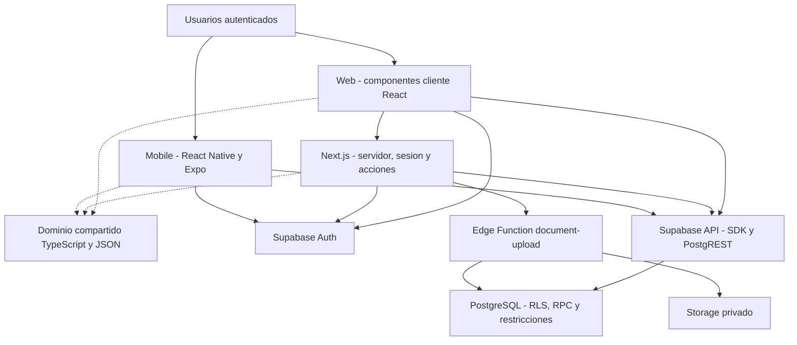
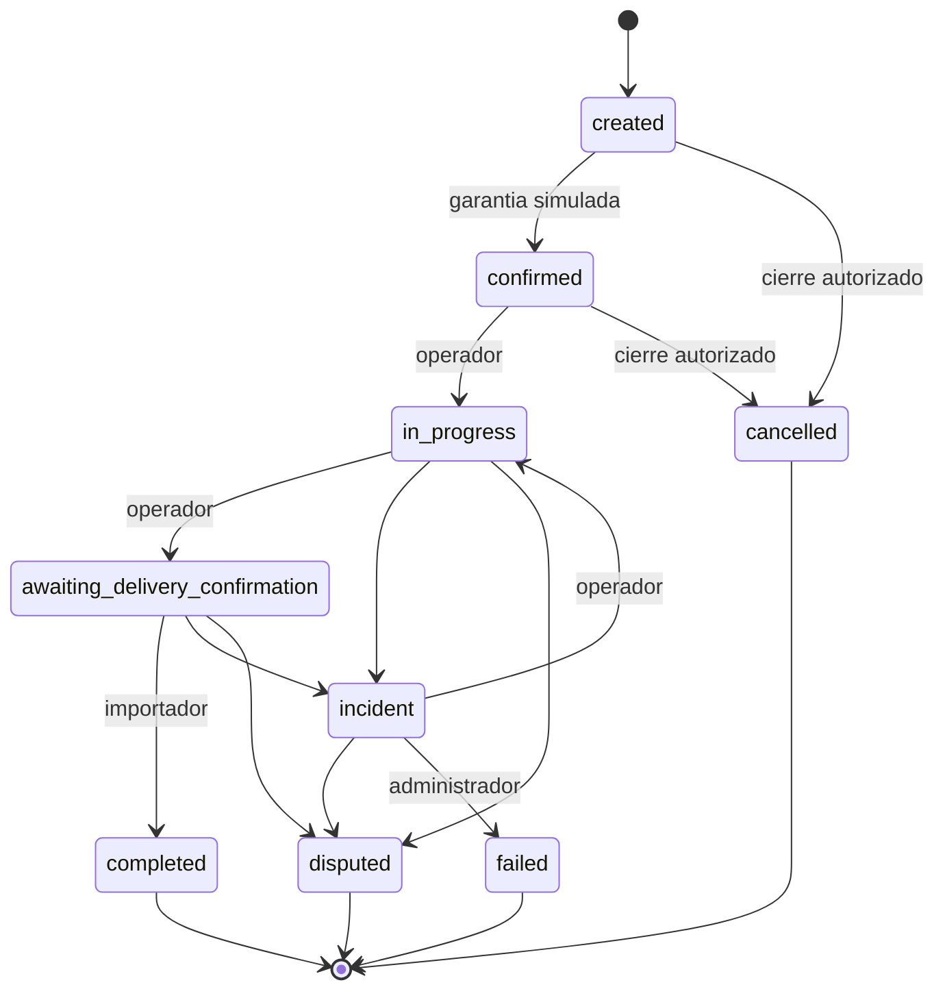

# 06. Arquitectura de 4PACK

Seminario Final — Chavez Yoshua Facundo. Corte: 15/11/2026. Estado del documento: **completo para revisión académica**.

## Organización actual

El repositorio es un monorepo con workspaces npm. `apps/web` contiene Next.js 16, React 19 y TypeScript; `apps/mobile` contiene React Native 0.81, Expo 54 y TypeScript; `packages/domain` reúne tipos, validaciones, taxonomía de servicios y contrato de estados. Las versiones exactas están en los manifiestos/lockfile del checkpoint, no se deducen de las etiquetas comerciales del proyecto.

No existe un servidor REST propio separado que implemente todo el negocio. Next.js resuelve renderizado, sesión y acciones de servidor; algunos componentes cliente y mobile usan el SDK de Supabase directamente bajo RLS. Las decisiones transaccionales sensibles se ejecutan en PostgreSQL mediante RPC. Los archivos pasan por una Edge Function de subida autorizada.

## Responsabilidades y fronteras

| Capa | Responsabilidad real | Frontera que no debe cruzar |
| --- | --- | --- |
| Cliente web | Formularios, navegación, comparación, acciones de importador y widgets interactivos. | No aprobar capacidad, modificar fases arbitrarias ni usar claves privilegiadas. |
| Servidor Next.js | Resolver usuario/rol, renderizar paneles, validar entradas, invocar RPC/gateway y revalidar vistas. | Una comprobación de interfaz no reemplaza la autorización en base. |
| Cliente mobile | Publicación y seguimiento del importador, garantía simulada, confirmación de entrega, mensajes. | No asumir que una pantalla heredada de cotización está habilitada; `submitOffer` permanece bloqueado. |
| Dominio compartido | Tipos, reglas reutilizables de formulario, etiquetas y grafo canónico de estados. | No mantener consumo financiero autoritativo en memoria del cliente. |
| PostgreSQL | Datos, integridad, RLS, RPC, locks, reservas, liberación y auditoría. | No exponer funciones internas que salteen Capacity o el control de estados. |
| Auth | Identidad y sesión. | Estar autenticado no equivale a ser operador aprobado o administrador. |
| Storage/gateway | Bytes privados, validación de formato/tamaño y asociación documental autorizada. | El nombre de archivo o una ruta conocida no concede permiso de lectura. |

## Seguridad y transacciones

La autorización combina sesión, rol persistido, titularidad/participación y estado. RLS limita consultas y escrituras de tablas; las RPC sensibles verifican actor y reglas. Las funciones `security definer` se usan con `search_path` fijado y permisos de ejecución explícitos. Las versiones internas renombradas de award/transición/garantía no son APIs de cliente.

En Capacity, todos los caminos públicos afectados toman primero el lock del operador, escriben el mutex, bloquean límites globales/monedas en orden determinista y luego entran al flujo de carga/operación. `award_offer` crea la operación y los triggers capturan contrato/reserva dentro de la misma transacción, junto con la garantía y eventos del flujo. Un rechazo revierte el conjunto. Las restricciones únicas e idempotencia evitan duplicar adjudicación y reserva; completed libera una sola vez, mientras disputed conserva consumo.

La base exige capital estimado explícito en propuestas nuevas y conserva datos desconocidos como revisión pendiente. Solo administración aprueba límites económicos; **se ejecuta una reserva transaccional, no una aprobación económica automática**. El importador recibe un rechazo genérico, sin exposición, límites o motivos privados.

Para documentos, Next invoca `document-upload` con la sesión del usuario. La función comprueba permisos y bytes antes de registrar el vínculo entre `documents` y `storage.objects`. Se valida PDF/PNG/JPEG y un máximo de 10 MiB. Esto detecta incompatibilidad de formato, no malware exhaustivo ni autenticidad jurídica del documento. La lectura debe satisfacer los permisos relacionados al documento.

Esa descripción corresponde al gateway y a los consumidores integrados. Existe una excepción heredada en `NewCargoForm`: la rama HAZMAT conserva subida directa a Storage e inserción de metadatos, incompatible con los permisos de 0015. Su compensación por DELETE también puede fallar por las políticas de 0016. Es una inconsistencia P1 detectada por lectura, sin reproducción remota ni corrección en esta tarea. No se presenta toda publicación con MSDS como integrada al gateway.

## Contrato compartido de Operations

La fuente es [operation-contract.json](../../packages/domain/src/operation-contract.json); el script [prepare-operation-contract](../../scripts/prepare-operation-contract.mjs) verifica su correspondencia SQL. No se usa un avance genérico de estados desde mobile operador.

El símbolo final desde disputed señala que **el contrato actual no define salidas**, no que cierre la obligación o libere capacidad. `status` mantiene una proyección heredada; `phase` es el estado detallado. Cancelled/failed exigen consecuencias registradas y no implementan por sí mismos reembolso ni controversia integral.

## Dos entornos de ejecución

**Ruta conectada:** SDK Supabase, Auth, PostgreSQL, Storage y Edge Function. Las configuraciones locales no prueban que esos servicios remotos estén migrados, desplegados o certificados.

**Demo local/Preview:** PGlite, paquete `demo-sql.json`, fixtures ficticios y archivos locales/temporales autorizados. Emula identidad y servicios necesarios para el recorrido del operador; no es un servidor Supabase completo. La política `isDemoEnabled` permite desarrollo local/Preview y bloquea producción. Preview usa almacenamiento temporal, sin promesa de durabilidad compartida entre instancias. Realtime real y varias conexiones PostgreSQL no quedan demostrados por esa emulación.

## Calidad y límites observados

El cierre 2B registró 89 pruebas automatizadas y 21 recorridos de navegador, typecheck, lint, builds y checks de contrato/sincronización. El informe técnico conserva comandos, tiempos, fallos iniciales corregidos y límites de evidencia. En esta tarea documental solo se repitió el chequeo de demo tras normalizar el EOF de 0021, no toda la regresión.

Pendientes de validación: concurrencia multiconexión y aislamiento real, roles/API remotos, Edge/Storage remoto, dispositivo mobile, recuperación/backup, monitoreo y carga. El mutex fuerza conflicto de escritura en snapshots antiguos, pero el cliente todavía requiere una política de reintento y observabilidad para operación intensiva. No hay SLA ni producción certificada.

## Despliegue previsto, no ejecutado

Hasta el 23/11/2026 se propone una demo académica reproducible y, si se autoriza y supera controles, una publicación de prueba web sobre Vercel con un entorno Supabase separado para pruebas conectadas. Cada modalidad debe indicar si usa demo PGlite o backend conectado; una Preview no demuestra ambos a la vez. Antes de cualquier migración remota corresponde respaldo, revisión de SQL/permisos, ensayo y autorización. En esta entrega no se hizo despliegue ni migración remota.

Mobile tiene export Android/Hermes generado en el cierre anterior; distribución firmada e instalación real permanecen sin acreditar. El producto comercial exigiría revisar pagos, contratos, operación logística, soporte y cumplimiento, además de infraestructura.

Fuentes: [manifiesto web](../../apps/web/package.json), [mobile](../../apps/mobile/package.json), [dominio](../../packages/domain/src/), [Supabase](../../supabase/), [informe 2B](../16-etapa-2b-capacity.md). Véase el [diagrama de componentes](07-diagrama-componentes.md) para las dependencias concretas.
