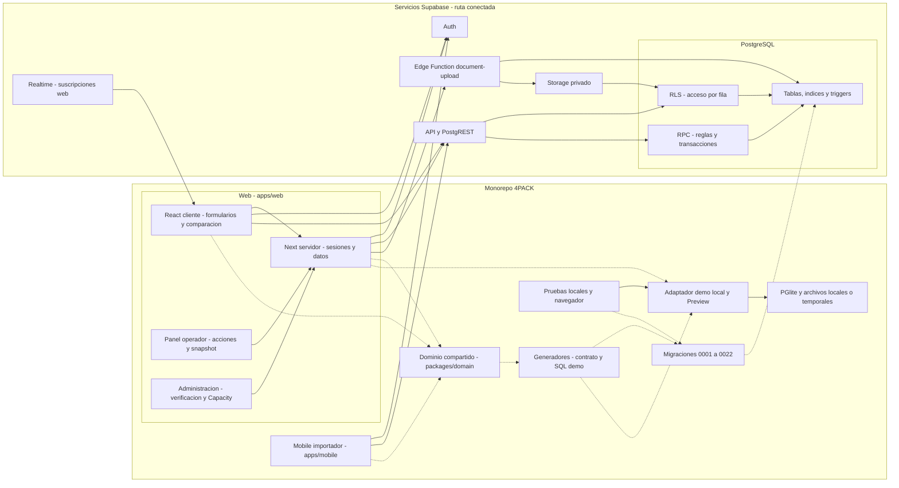

# 07. Diagrama de componentes de 4PACK

Seminario Final — Chavez Yoshua Facundo. Corte: 15/11/2026. Estado del documento: **completo para revisión académica**.

## Componentes actuales y dependencias

Las flechas continuas indican una llamada/uso en ejecución. Las discontinuas indican dependencia de código/configuración o una ruta alternativa de demo. RLS y RPC se dibujan dentro de PostgreSQL: no son microservicios externos.

La flecha migraciones → tablas expresa el destino previsto del esquema, **no una migración remota ejecutada en este cierre**. El flujo Storage → RLS remite a las políticas sobre `storage.objects` y su asociación documental. Las suscripciones Realtime existen en web; su operación conectada depende de la configuración del servicio y no queda certificada por la demo.

## Responsabilidades y evidencia

| Componente | Responsabilidad | Fuente |
| --- | --- | --- |
| Web importador | Publicación, comparación, adjudicación, consulta de operación y documentos. | [app](../../apps/web/src/app/), [componentes](../../apps/web/src/components/), [dashboard-data](../../apps/web/src/lib/dashboard-data.ts). |
| Web operador | Oportunidades, borradores/ofertas, operaciones, documentos, historial, billetera simulada, soporte, perfiles y consulta de Capacity. | [features/operator](../../apps/web/src/features/operator/). |
| Administración | Verificación/moderación y aprobación económica por operador con auditoría. | [app/admin](../../apps/web/src/app/admin/), [features/capacity](../../apps/web/src/features/capacity/). |
| Mobile importador | Publicar/consultar, seguir operación, simular garantía, confirmar entrega y enviar mensajes. | [app mobile](../../apps/mobile/app/), [dashboard mobile](../../apps/mobile/lib/dashboard.ts). |
| Dominio | Tipos, validaciones de cotización, taxonomía y estados comunes. | [packages/domain/src](../../packages/domain/src/). |
| Auth/API | Autenticación y acceso con la identidad de sesión a tablas/RPC. | Clientes [web](../../apps/web/src/lib/supabase/) y [mobile](../../apps/mobile/lib/supabase.ts). |
| RPC/RLS | Autorización y consistencia transaccional, independiente del cliente. | [migraciones](../../supabase/migrations/), en particular 0015–0022. |
| Gateway/Storage | Validación de bytes, vinculación del objeto y protección de documentos privados. | [document-upload](../../supabase/functions/document-upload/index.ts), [validador](../../supabase/functions/_shared/document-validation.mjs). |
| Demo | Cargar SQL/fixtures ficticios en PGlite y resolver identidad/archivos simulados del recorrido web. | [demo-runtime](../../apps/web/src/features/operator/demo-runtime.mjs), [seed Capacity](../../supabase/demo/stage2b-capacity-seed.sql). |
| Verificación | Dominio, DB/RLS, upgrade, privacidad, navegador y paquete Preview. | [tests](../../tests/), scripts del [package.json](../../package.json). |

## Decisiones de diseño

El monorepo permite compartir contratos sin convertir el sistema en microservicios. PostgreSQL concentra la adjudicación y Capacity porque una reserva calculada solo en cliente puede quedar desactualizada. El servidor web agrega controles y experiencia, pero no es el único consumidor del backend: mobile y algunos componentes cliente también acceden mediante SDK.

La demo es un adaptador alternativo de la web, no el backend de mobile. No se conecta PGlite a Supabase remoto ni se sincronizan fondos. Los generadores empaquetan SQL/fixtures y verifican el contrato; no son servicios de negocio desplegados.

**Implementado:** componentes descritos y contratos locales. **Parcial:** ensayo conectado remoto, observabilidad, concurrencia real y experiencia bilateral integral de reputación. **Planificado hasta el 23/11/2026:** integración/verificación del flujo existente y demostración condicionada a disponibilidad/autorización. **Fuera del MVP:** componentes de pagos reales, direct/rehire, pagos por tramos, controversias completas y nuevas funciones de Reputation. No se dibujan como servicios ya construidos.
