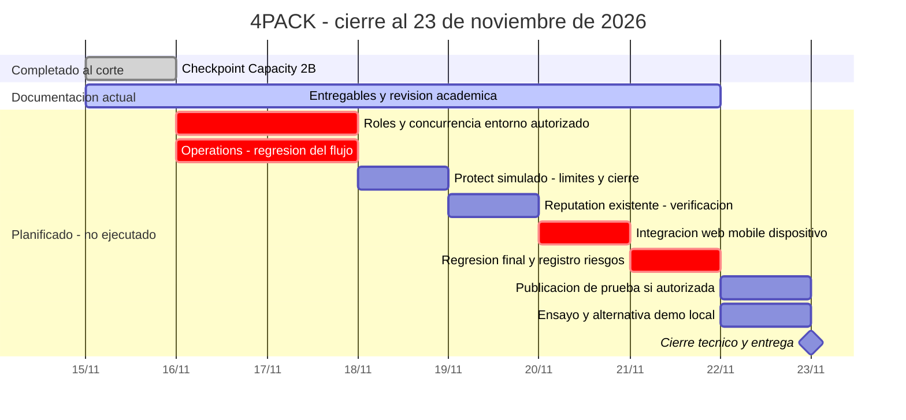

# 08. Cronograma de cierre técnico y académico de 4PACK

Alumno: Chavez Yoshua Facundo — Analista de Sistemas — Seminario Final. Profesor: Francisco Montero. Última actualización: **15/11/2026**. Cierre técnico planificado: **23/11/2026**. Estado del documento: **en revisión**, sujeto a disponibilidad del alumno y de entornos/dispositivo.

## Criterio de planificación

El punto de partida es Capacity 2B aprobado localmente y preservado en `de5e3eeb562d44f848c0e18addcbaef6e9bbcde2`. No se reconstruye una historia de fechas de desarrollo sin evidencia: el único hito técnico completado que se fecha en este gráfico es el checkpoint realizado el 15/11.

Quedan ocho días posteriores al corte. Se prioriza estabilizar y demostrar **Operations existente, Protect simulado existente y Reputation existente**, sin convertir sus nombres en módulos nuevos. El cronograma es una propuesta de cierre, no una orden de implementar ni de publicar. La disponibilidad diaria no fue confirmada; los esfuerzos son rangos orientativos y no compromisos de entrega.

## Trabajo, evidencia de salida y restricciones

| ID / tarea | Estado al 15/11 | Ventana propuesta | Esfuerzo orientativo | Criterio de salida |
| --- | --- | --- | --- | --- |
| GT-01. Preservar Capacity 2B | Completado | 15/11 | Ejecutado | Commit local, 35 archivos legítimos, `diff --cached --check` sin errores y demo sincronizada. |
| GT-02. Documentación académica | Actual; documentos producidos, revisión pendiente | 15–21/11 | 4–6 h de revisión posterior | Requisitos/casos/modelos consistentes; fuentes, diagramas y enlaces validados; devolución docente incorporable sin atribuir aceptación ya obtenida. |
| GT-03. Roles y concurrencia | Planificado hasta el 23/11/2026 | 16–17/11 | 4–6 h | Ensayo PostgreSQL multiconexión y permisos en entorno autorizado; o bloqueo registrado y alcance de la demo limitado a local. Depende de acceso y respaldo. |
| GT-04. Operations actual | Planificado: regresión | 16–17/11 | 2–3 h | Adjudicación, garantía simulada, hitos, entrega y Capacity verificadas; casos inválidos rechazados. No crear nuevos estados o controversias. |
| GT-05. Protect simulado | Planificado: revisión de lo existente | 18/11 | 2–3 h | Aclaraciones visibles y coherencia de garantía, comisión, wallet y cierre; no presentar simulación como custodia. Si aparece un defecto, registrar prioridad y solicitar otro alcance de corrección. |
| GT-06. Reputation existente | Planificado: verificación | 19/11 | 1–2 h | Reglas bilaterales, separación por rol y ausencia de historial revisadas; limitación de UI documentada. No añadir Reputation adicional. |
| GT-07. Integración web/mobile | Planificado | 20/11 | 3–4 h | Recorrido importador en dispositivo, coherencia de moneda/estado y cambio de canal a web. No ampliar las funciones nativas. |
| GT-08. Regresión y evidencia | Planificado | 21/11 | 3–4 h | Ejecutar checks acordados, conservar resultados/errores y decidir si los riesgos permiten demo conectada. |
| GT-09. Publicación académica condicionada | Pendiente de autorización, no ejecutado | 22/11 | 1–2 h si está preparada | Solo si existen autorización, entorno/configuración y checks aprobados. No implica producción certificada. Si no, usar demo local sin mover la fecha de entrega. |
| GT-10. Ensayo, contingencia y cierre | Planificado | 22–23/11 | 2–3 h | Guion reproducible, distinción demo/conectado y revisión final de documentación/limitaciones; entrega al 23/11. |

El esfuerzo posterior estimado es **22–33 horas**, con documentación repartida en bloques breves. GT-03 y GT-04 se solapan porque comparten preparación y recorrido; no se supone un equipo paralelo. Si no se dispone de esas horas o de infraestructura, se reduce la demo a funciones locales verificadas y se declara la limitación. No se reserva tiempo para desarrollar módulos nuevos.

## Dependencias y criterio de recorte

La ruta de mayor riesgo es permisos/concurrencia → integración → regresión → eventual publicación. El funcionamiento local no satisface automáticamente el primer eslabón. Debe revisarse la disponibilidad del entorno al inicio del 16/11 para no descubrir el bloqueo el día de entrega.

Ante un P0 se suspende la demostración del flujo afectado. Ante un P1 de concurrencia o autorización sin resolver, no se promete operación conectada multiusuario; se conserva el alcance local con explicación. El tiempo de contingencia se usa para reproducibilidad y documentación, no para contratar proveedores, resolver regulación de pagos o completar controversias.

**Fuera del MVP de este cierre:** direct, rehire, Protect 3.0 completo, pagos por tramos, controversias completas, reputación adicional, integraciones aduaneras/transportistas, pagos reales, certificación productiva y distribución nativa firmada garantizada.

Referencias: [estado técnico 2B](../16-etapa-2b-capacity.md), [requisitos web](01-requisitos-web.md), [mobile](02-requisitos-mobile.md), [viabilidad](11-analisis-viabilidad.md). Las tareas futuras no fueron ejecutadas como parte de esta documentación.
